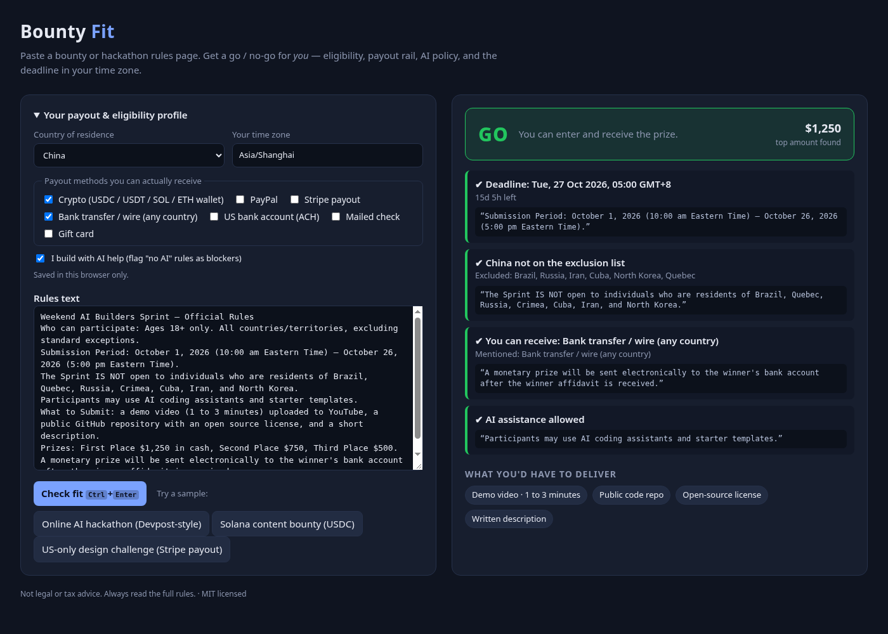

# Bounty Fit

**Paste a bounty or hackathon rules page. Get a go / no-go for *you* — can you enter, and can you actually get paid?**

Bounty lists tell you the prize. They don't tell you that your country is excluded on page 4 of the rules, that the prize only pays out via Stripe to a US bank account, that AI-assisted entries are disqualified, or that "5:00 pm EDT" is 5 a.m. tomorrow where you live. Bounty Fit reads the rules against your personal **payout & eligibility profile** and shows a traffic-light verdict where every finding quotes the sentence it came from.



## What it checks
| Check | Example finding |
|---|---|
| Deadline → your time zone + countdown | `Deadline: Tue, 27 Oct 2026, 05:00 GMT+8 · 15d 5h left` |
| Country exclusions / "only open to" lists | `✖ Only open to: the United States and Canada` |
| Payout rails vs. what you can receive | `✖ No payout rail you can receive — pays via Stripe, US bank (ACH)` |
| AI policy | `✖ AI-generated work restricted` / `✔ AI assistance allowed` |
| Deliverables | `Demo video · 1 to 3 minutes`, `Public code repo`, `Open-source license` |
| Prize | largest amount found (`$1,250`, `500 USDC`) |

Verdict: **NO-GO** if any blocker, **CHECK** if something is unresolved, **GO** otherwise.

## Run it (no install, no API keys, works offline)
```bash
# option 1: just open the file
open index.html            # or double-click it

# option 2: local server
npm start                  # → http://localhost:5173
npm test                   # 7 extractor/verdict tests (Node ≥ 18, no dependencies)
```

## Demo steps (what the video shows)
1. Open the app. The profile is pre-filled: China, Asia/Shanghai, crypto wallet + bank transfer, "I build with AI".
2. Click **Online AI hackathon** → **GO**: China not excluded, bank payout receivable, AI allowed, deadline shown in UTC+8.
3. Click **Solana content bounty** → **GO** (500 USDC to a Solana wallet).
4. Untick **Crypto** in the profile → verdict flips live to **NO-GO** with the quoted payout sentence.
5. Click **US-only design challenge** → **NO-GO** with three blockers (country, payout, AI policy).
6. Switch country to United States and tick Stripe + US bank → only the AI rule still blocks.

Demo deep links (handy for recording): `index.html#sample=1&rails=paypal,bank`, `index.html#sample=2&country=United%20States&rails=stripe,usbank`.

## How it works
- `src/fit.js` — the extractor (sentence-level pattern matching for dates/zones, country lists, payout rails, AI policy, deliverables, prize) and the judge (verdict rules). Same file runs in the browser and in Node tests.
- `app.js` — profile form (saved in `localStorage`), samples, rendering.
- No network calls; pasted text never leaves the browser.
- `samples/samples.js` — synthetic rules texts written for the demo.

Deliberately rule-based rather than LLM-based: free, offline, deterministic, and every finding is explainable with a quote. An optional local-LLM fallback for messy pages is on the "later" list.

## Built with the Devpost Learn Skill Pack
Planned and built with `npx skills add challengepost/learn-ai-basics` in a coding agent. The planning docs live in [`devpost/`](devpost/): [`scope.md`](devpost/scope.md), [`prd.md`](devpost/prd.md), [`spec.md`](devpost/spec.md), [`checklist.md`](devpost/checklist.md).

## Limits
Not legal or tax advice. Pattern matching can miss unusual phrasing — the verdict says CHECK when it can't find something, and you should always read the full rules.

## License
MIT — see [LICENSE](LICENSE).
